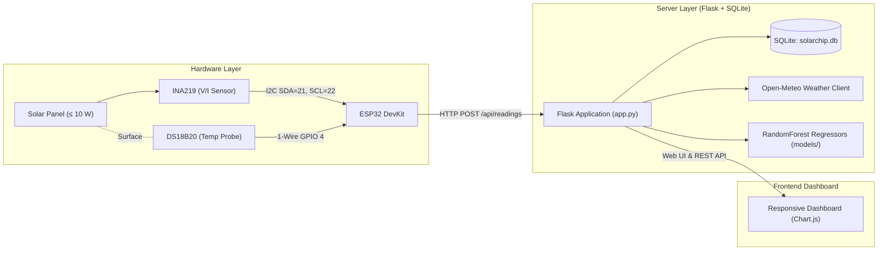

# ☀️ SolarChip — IoT Solar PV Monitoring & Forecasting

A complete, responsive web application for real-time solar photovoltaic monitoring and day-ahead generation forecasting. 

An **ESP32 microcontroller** streams voltage, current, and panel surface temperature over Wi-Fi to a **Flask backend**. Sensor readings are stored in **SQLite**, integrated into daily energy totals, cross-referenced with **Open-Meteo** solar irradiance forecasts, and visualized on an accessible, responsive dashboard.

---

## ⚠️ Important Forecaster & Model Disclaimer

> [!WARNING]
> **Demo Machine Learning Models**:
> The default ML models included in this repository are trained on **synthetic physics-based simulation curves**. 
> They demonstrate end-to-end data pipelines, real-time inference, and UI visualization.
>
> **Do NOT cite synthetic validation metrics (e.g., MAE) as real-world solar forecasting accuracy.** 
> To achieve scientific validity for production installations, retrain `train_model.py` with empirical on-site time-series data measured from calibrated pyranometers and long-term PV installations.

---

## Table of Contents
1. [System Architecture](#system-architecture)
2. [Prerequisites](#prerequisites)
3. [Quick Start (Backend & Dashboard)](#quick-start-backend--dashboard)
4. [Testing Without Hardware (API Simulation)](#testing-without-hardware-api-simulation)
5. [Hardware Setup & ESP32 Configuration](#hardware-setup--esp32-configuration)
6. [API Specification](#api-specification)
7. [Units & Calculations](#units--calculations)
8. [Troubleshooting Guide](#troubleshooting-guide)
9. [Educational Safety Notice](#educational-safety-notice)

---

## System Architecture



---

## Prerequisites

- **Python**: Version 3.10 or newer (tested on Python 3.10 – 3.13)
- **Node.js / npm**: Not required (vanilla HTML5/CSS/JavaScript with CDN Chart.js)
- **Arduino IDE**: Version 2.0+ (if programming the ESP32 hardware)

---

## Quick Start (Backend & Dashboard)

### 1. Clone & Enter Project Directory
```bash
cd "d:/Development/Projects/solar forecast"
```

### 2. Create and Activate Virtual Environment

**Windows (PowerShell):**
```powershell
python -m venv .venv
.\.venv\Scripts\Activate.ps1
```
*(If PowerShell blocks script execution, run `Set-ExecutionPolicy -ExecutionPolicy RemoteSigned -Scope CurrentUser`)*

**Windows (Command Prompt):**
```cmd
python -m venv .venv
.venv\Scripts\activate.bat
```

**macOS / Linux:**
```bash
python3 -m venv .venv
source .venv/bin/activate
```

### 3. Install Dependencies
```bash
pip install -r requirements.txt
```

### 4. Configure Environment Variables
Copy `.env.example` to `.env`:

**Windows (PowerShell):**
```powershell
Copy-Item .env.example .env
```

**Linux / macOS / Git Bash:**
```bash
cp .env.example .env
```

Edit `.env` to configure your location coordinates and panel rating:
```env
LATITUDE=13.0827
LONGITUDE=80.2707
LOCATION_NAME=Chennai, India
PANEL_RATED_WATTS=5.0
HOST=0.0.0.0
PORT=5000
FLASK_DEBUG=false
```

### 5. Train Demo Models
Generate the demonstration Random Forest models:
```bash
python train_model.py
```
This builds `models/power_model.joblib` and `models/season_model.joblib`.

### 6. Start the Flask Server
```bash
python app.py
```

### 7. Open Dashboard
Open your browser and navigate to:
```
http://127.0.0.1:5000
```

---

## Testing Without Hardware (API Simulation)

You do not need physical hardware to test the dashboard. You can send test telemetry directly into the API.

### Option A: Click the UI Demo Button
1. Open `http://127.0.0.1:5000` in your browser.
2. In the "No Sensor Telemetry Received Yet" box, click **🚀 Send Sample Reading from Browser**.
3. Telemetry graphs and metric cards will update immediately.

### Option B: Using curl

**Windows (Command Prompt):**
```cmd
curl -X POST http://127.0.0.1:5000/api/readings -H "Content-Type: application/json" -d "{\"voltage\": 5.2, \"current\": 0.35, \"panel_temp\": 38.5}"
```

**Windows (PowerShell):**
```powershell
Invoke-RestMethod -Uri "http://127.0.0.1:5000/api/readings" -Method POST -ContentType "application/json" -Body '{"voltage": 5.2, "current": 0.35, "panel_temp": 38.5}'
```

**Linux / macOS / Bash:**
```bash
curl -X POST http://127.0.0.1:5000/api/readings \
  -H "Content-Type: application/json" \
  -d '{"voltage": 5.2, "current": 0.35, "panel_temp": 38.5}'
```

### Option C: Using Python
```python
import requests

payload = {
    "voltage": 5.15,
    "current": 0.38,
    "panel_temp": 36.4
}
res = requests.post("http://127.0.0.1:5000/api/readings", json=payload)
print(res.status_code, res.json())
```

---

## Hardware Setup & ESP32 Configuration

### Exact Bill of Materials
| No. | Exact Component Name | Qty | Role in SolarChip |
| :--- | :--- | :---: | :--- |
| 1 | **6V, 5W Mini Solar Panel** | 1 | Power generation source |
| 2 | **ESP32 DevKit V1 (ESP32-WROOM-32)** | 1 | Microcontroller, Wi-Fi telemetry & node controller |
| 3 | **INA219 Voltage & Current Sensor Module** | 1 | High-side bus voltage & current measurement (I2C) |
| 4 | **DS18B20 Waterproof Temperature Sensor** | 1 | Measures solar panel surface temperature (1-Wire) |
| 5 | **DHT22 / AM2302 Sensor Module** | 1 | Measures ambient air temperature & humidity |
| 6 | **0.96-inch I2C OLED Display (SSD1306, 128×64)** | 1 | Real-time on-device status, power & IP display |
| 7 | **Breadboard** | 1 | Solderless prototyping circuit assembly |
| 8 | **Jumper Wire Kit** | 1 | Circuit interconnects (M-M, M-F, F-F) |
| 9 | **4.7kΩ Resistor** | 1 | Required pull-up resistor for DS18B20 data line |
| 10 | **6V, 3W DC Lamp (Testing Load)** | 1 | Draws active current to evaluate real power output |
| — | **Micro-USB Data Cable** | 1 | Flashing firmware & serial power |

---

### Complete Breadboard Wiring Guide

```
                        +----------------------------+
                        |  6V, 5W Solar Panel (+)    |
                        +--------------+-------------+
                                       |
                                       v
                                [ INA219 VIN+ ]
                                [ INA219 VIN- ] --------+
                                                        |
                        +----------------------------+  |
                        |   6V, 3W DC Lamp (Load)    |<-+
                        +--------------+-------------+
                                       |
+--------------------------------------+--------------------------------------+
|                               COMMON GROUND (GND)                           |
+-----------------------------------------------------------------------------+
```

#### Sensor Pinout & ESP32 Connections
| Component | Component Pin | Connects To | Description |
| :--- | :--- | :--- | :--- |
| **INA219** | VCC | **ESP32 3.3V** (or 5V) | Power supply |
| **INA219** | GND | **ESP32 GND** | Common ground |
| **INA219** | SDA | **ESP32 GPIO 21** | Shared I2C Data bus |
| **INA219** | SCL | **ESP32 GPIO 22** | Shared I2C Clock bus |
| **INA219** | VIN+ | **Solar Panel (+)** | Input from panel positive |
| **INA219** | VIN- | **6V 3W Lamp (+)** | Output to lamp load positive |
| **OLED 0.96"** | VCC | **ESP32 3.3V** | Power supply |
| **OLED 0.96"** | GND | **ESP32 GND** | Common ground |
| **OLED 0.96"** | SDA | **ESP32 GPIO 21** | Shared I2C Data bus |
| **OLED 0.96"** | SCL | **ESP32 GPIO 22** | Shared I2C Clock bus |
| **DS18B20** | VDD (Red) | **ESP32 3.3V** | Sensor power |
| **DS18B20** | GND (Black) | **ESP32 GND** | Common ground |
| **DS18B20** | DATA (Yellow) | **ESP32 GPIO 4** | 1-Wire Data (**attach 4.7kΩ to 3.3V**) |
| **DHT22** | VCC (+) | **ESP32 3.3V** | Sensor power |
| **DHT22** | GND (-) | **ESP32 GND** | Common ground |
| **DHT22** | DATA (Out) | **ESP32 GPIO 18** | Ambient temp & humidity data |
| **6V Lamp** | Return (-) | **ESP32 GND & Panel (-)** | Closes the DC load circuit |

---

### Flashing the ESP32

1. Open **Arduino IDE** (version 2.0+).
2. Install the ESP32 board definition: `Tools` → `Board` → `Boards Manager` → Search **`esp32 by Espressif`**.
3. Install required libraries via **`Sketch` → `Include Library` → `Manage Libraries`**:
   - **`Adafruit INA219`** by Adafruit
   - **`Adafruit SSD1306`** by Adafruit
   - **`Adafruit GFX Library`** by Adafruit
   - **`OneWire`** by Paul Stoffregen
   - **`DallasTemperature`** by Miles Burton
   - **`DHT sensor library`** by Adafruit
4. Open [`esp32/solarchip_esp32.ino`](file:///d:/Development/Projects/solar%20forecast/esp32/solarchip_esp32.ino).
5. Edit your Wi-Fi credentials:
   ```cpp
   const char* WIFI_SSID     = "Your_WiFi_Name";
   const char* WIFI_PASSWORD = "Your_WiFi_Password";
   ```
6. Set `SERVER_URL` to your computer's local IP on the network:
   ```cpp
   const char* SERVER_URL    = "http://192.168.1.100:5000/api/readings";
   ```
7. Select **ESP32 Dev Module** and the correct COM port, then click **Upload**.
8. Open the Serial Monitor at **115200 baud** to see real-time sensor diagnostics and HTTP transmission statuses.

---

## API Specification

All responses are returned with HTTP `application/json` content type.

| Endpoint | Method | Description |
| :--- | :--- | :--- |
| `/` | `GET` | Main responsive monitoring and forecasting dashboard |
| `/api` | `GET` | Catalog of available API endpoints and documentation |
| `/api/readings` | `POST` | Ingest sensor reading from ESP32. Requires `voltage` and `current`. |
| `/api/readings` | `GET` | Fetch historical sensor readings. Supports `?limit=100` (max 1000). |
| `/api/readings/latest`| `GET` | Returns single most recent reading with freshness indicators. |
| `/api/dashboard` | `GET` | Consolidated payload: latest reading, today's Wh, recent points, hardware config. |
| `/api/forecast` | `GET` | 24-hour hourly generation predictions using Open-Meteo weather data. |
| `/api/seasonal` | `GET` | 12-month illustrative seasonal estimates (daily Wh/day). |
| `/api/status` | `GET` | System health check, sensor staleness indicator, and deviation alert. |

---

## Units & Calculations

- **Instantaneous Power (Watts, W)**:
  $$\text{Power (W)} = \text{Voltage (V)} \times \max(0, \text{Current (A)})$$
- **Accumulated Daily Energy (Watt-hours, Wh)**:
  Integrated over consecutive readings using trapezoidal numerical integration:
  $$E = \sum \frac{P_k + P_{k+1}}{2} \times \frac{\Delta t_k}{3600}$$
  *(Integration pauses if sensor readings have a gap $> 5$ minutes to prevent overestimating energy during outages)*.
- **Kilowatt-hours (kWh)**:
  $$\text{Energy (kWh)} = \frac{\text{Energy (Wh)}}{1000}$$
- **Thermal Panel Estimation**:
  Estimated future operating cell temperature from irradiance:
  $$T_{\text{panel}} \approx T_{\text{ambient}} + G \times 0.025\,^\circ\text{C}/(\text{W/m}^2)$$

---

## Troubleshooting Guide

### 1. Dashboard says "Backend Offline" or "Awaiting ESP32"
- Verify Flask is running in terminal: `python app.py`.
- Click "Refresh Now" on the dashboard.
- Send a sample reading with `curl` to confirm the backend persists data to `solarchip.db`.

### 2. ESP32 shows `[HTTP ERROR] Failed to connect`
- Confirm your computer and ESP32 are connected to the **same Wi-Fi network**.
- Verify `SERVER_URL` in `solarchip_esp32.ino` points to your computer's local LAN IP (e.g. `192.168.1.100`), **not** `127.0.0.1` or `localhost`.
- Check your computer's firewall: allow incoming TCP connections on port 5000.

### 3. Open-Meteo Weather says "Offline"
- The backend handles external weather timeouts gracefully. If internet connectivity drops, the local telemetry dashboard continues recording readings without interruption.
- Check if your firewall or proxy blocks outgoing requests to `https://api.open-meteo.com`.

### 4. DS18B20 returns disconnected or -127°C
- Ensure a **4.7 kΩ pull-up resistor** is securely placed between the DS18B20 Data pin (GPIO 4) and 3.3V.
- Verify sensor wiring and ground connections.

---

## Educational Safety Notice

> [!CAUTION]
> **Low-Voltage Educational Setup Only**:
> 1. Use **only small, low-voltage educational solar panels** (rated $\le 10\text{ W}$, open-circuit voltage $V_{oc} \le 21\text{ V}$).
> 2. The INA219 breakout board is rated for DC voltages under $26\text{ V}$ and currents under $3.2\text{ A}$ (with default $0.1\,\Omega$ shunt).
> 3. **NEVER** connect experimental prototype wiring or breadboards to AC mains power, high-voltage battery strings, or building rooftop PV installations.
> 4. Always have an experienced laboratory supervisor inspect circuit polarity and load resistance before illuminating the solar panel.
